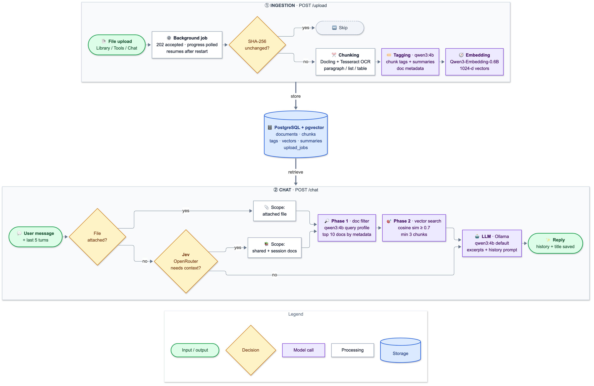

# RAG
A basic AI assistent running fully on local models (Ollama) that uses the concept of RAG: Retrival Augmented Generation using an outside database that the model was not trained on.

It uses Jev (OpenRouter) to decide if the AI needs additional context or not.

## Architecture

Source: [`architecture.mmd`](architecture.mmd). Re-render with `npx @mermaid-js/mermaid-cli -i architecture.mmd -o architecture.png -b white --size 2000 -s 2`.
